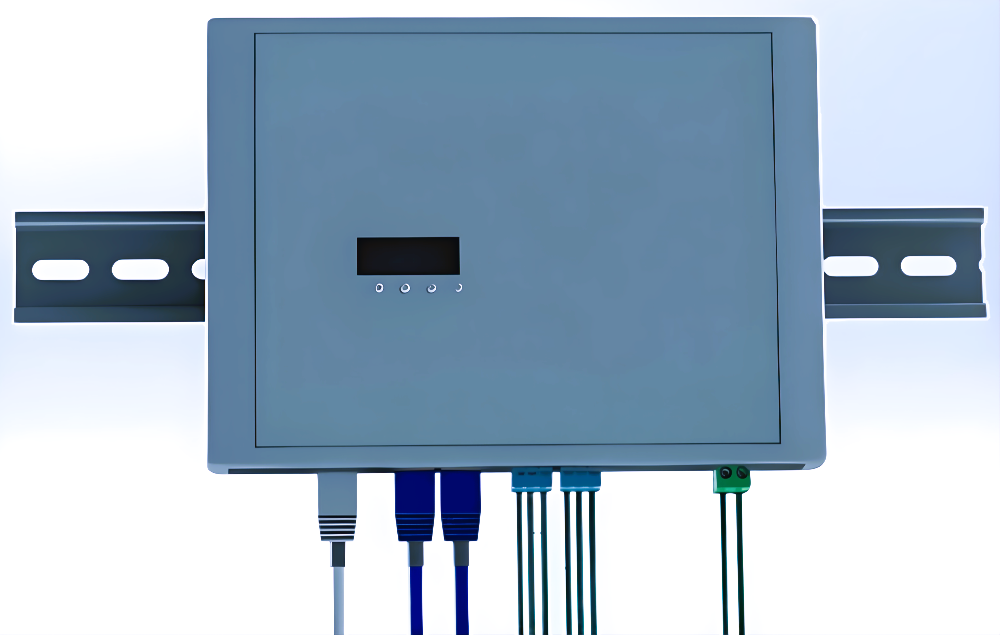
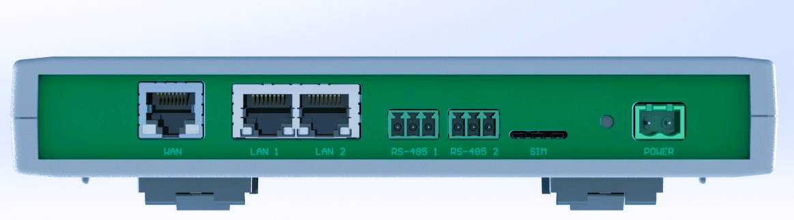
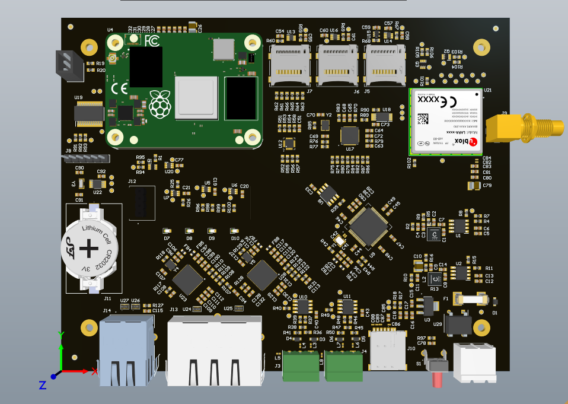
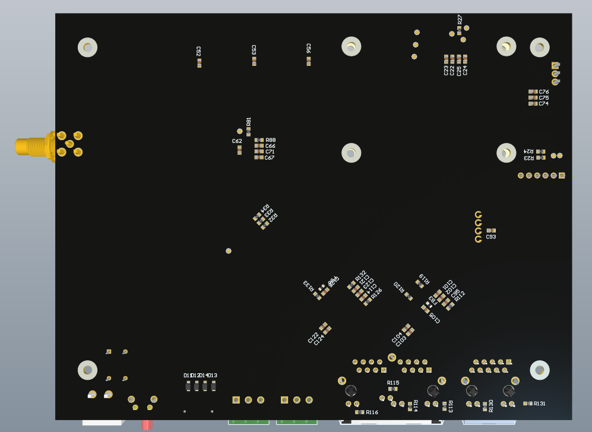
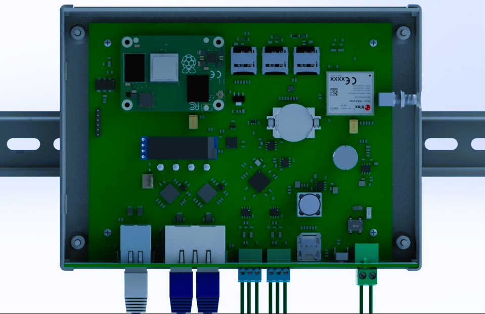
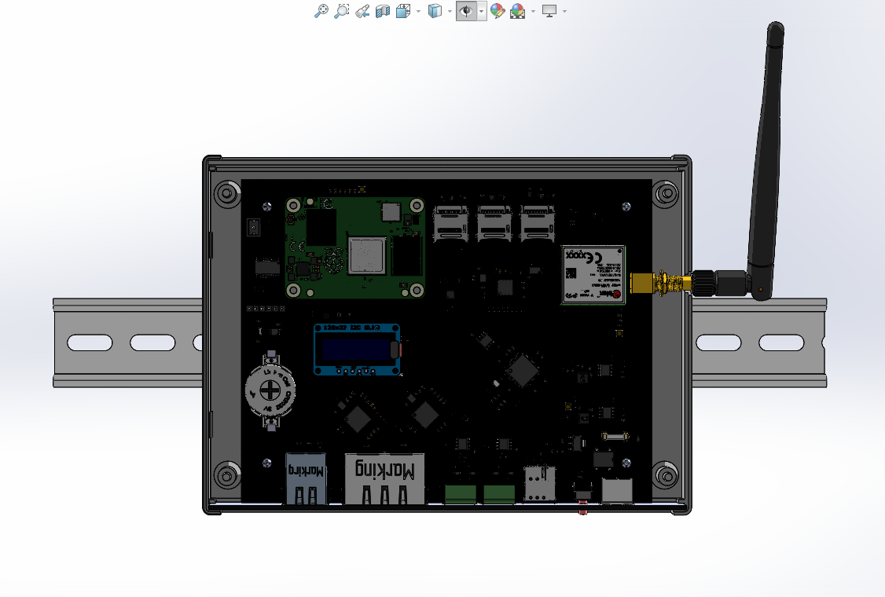

# Compute Module 4 Gateway

DIN-rail industrial gateway built around the Raspberry Pi Compute Module 4. The
carrier board adds two extra Ethernet ports, two RS-485 ports, a u-blox LARA-R6
LTE modem, three SD card slots, an RTC, a 128×32 OLED and a PIC supervisor. A
PCB doubles as the front panel of the enclosure.

[](images/enclosure-front-din-rail.png)

| Connector panel | Front-panel PCB |
| --- | --- |
| [](images/enclosure-connector-panel.png) | [](images/front-panel-pcb.png) |

| PCB top | PCB bottom |
| --- | --- |
| [](images/pcb-3d-top.png) | [](images/pcb-3d-bottom.png) |

| Enclosure open | SolidWorks assembly |
| --- | --- |
| [](images/enclosure-open-top-view.png) | [](images/enclosure-assembly-solidworks.png) |

## On the board

| Ref | Part | Role |
| --- | --- | --- |
| U4 | Raspberry Pi CM4 (2× Hirose DF40 connectors) | Main computer |
| J14 | Würth 7499111121A RJ45 | `WAN` port (CM4 Ethernet) |
| U23, U28, J13 | 2× LAN9500A + Würth 7499021125 dual RJ45 | `LAN 1`, `LAN 2` (USB Ethernet) |
| U17 | USB2514B | USB 2.0 hub feeding the on-board USB devices |
| U9, U8 | FT2232HL + 93C46B EEPROM | Dual USB-UART for the RS-485 ports |
| U10, U11, J3, J4 | 2× SN75176A + 3-way pluggable terminals | `RS-485 1`, `RS-485 2` |
| U21, J9, J10 | LARA-R6001D + SMA antenna connector + SIM holder | LTE modem |
| U12, J5–J7, U13, U14, U16 | MAX4996 + 3× Molex 47219 microSD + 3× TPS22919 | Three switchable SD card slots with per-slot power |
| U22, Y3, J11 | MCP7940NT + 32.768 kHz crystal + CR2032 holder | Battery-backed RTC |
| J12 | 128×32 OLED module | Status display (I²C) |
| U18 | AT24C04D | I²C EEPROM |
| U19 | PIC16F18857 | Supervisor MCU |
| D7–D10 | Würth 150060 LEDs (red, 2× green, blue) | Status LEDs |
| S1 | 1-1825027-2 | Push button |
| J1, F1, U29 | 2-way power terminal + fuse + DF10M bridge | DC input (`VCC_SYS`), either polarity |
| U1, U2 | 2× LMR33640 | Buck converters for the 5 V and 3.8 V (modem) rails |
| U3 | TLV1117LV33 | 3.3 V LDO |

> Differences from the previous README: it gave a 5 V DC input, four USB 2.0
> ports and dual SD slots. The schematic generates 5 V on board with an LMR33640
> from a rectified input (so the input must be higher than 5 V), places no
> USB-A connectors (the hub only feeds on-board devices), and has three SD
> slots. It also did not mention the two RS-485 ports.

## Repository layout

```
0012_compute_module_4_gateway/
├── PCB/                                  # Altium Designer project, main board
│   ├── cm4gateway.PrjPcb                 # Project file (open this)
│   ├── cm4gateway.SchDoc                 # Top sheet
│   ├── POWER SUPPLY.SchDoc, Rpi.SchDoc, CELLULAR.SchDoc, ETHERNET.SchDoc,
│   │   USB HUB.SchDoc, RS-485.SchDoc, SD-CARD.SchDoc, I2C.SchDoc,
│   │   CPU_superviser.SchDoc             # Sheets
│   ├── *.Harness                         # Signal harness definitions
│   ├── cm4gateway.PcbDoc                 # PCB layout
│   ├── cm4gateway.PCBDwf                 # Draftsman drawing
│   ├── OutJob.OutJob                     # Output job
│   └── Project Outputs for WIFI_RM/      # PDFs and STEP
├── front-panel/                          # Altium project for the front-panel PCB (no components)
├── mechanical/                           # SolidWorks DIN-rail enclosure (RM2055S)
│   ├── RM2055S.SLDASM                    # Enclosure assembly
│   ├── RM2055S_SOLID_DRAWING.SLDDRW      # Drawing
│   ├── *.SLDPRT                          # Enclosure, PCB, OLED, DIN rail, cable and screw models
│   └── drawings/                         # PDF exports
├── scripts/                              # Python scripts for the OLED, network status and GPIO tests
└── images/                               # Renders used in this README
```

## Component library

This repo stores no libraries. Every part comes from the general Altium library
in [Gueni/0000_libraries](https://github.com/Gueni/0000_libraries):

| File | Used for |
| --- | --- |
| [`Altium/DATABASE.DbLib`](https://github.com/Gueni/0000_libraries/blob/master/Altium/DATABASE.DbLib) | Database library the schematic components link to |
| [`Altium/DB.mdb`](https://github.com/Gueni/0000_libraries/blob/master/Altium/DB.mdb) | Parts database (part numbers, MPNs, suppliers) |
| [`Altium/SCH.SchLib`](https://github.com/Gueni/0000_libraries/blob/master/Altium/SCH.SchLib) | Schematic symbols |
| [`Altium/FTP.PcbLib`](https://github.com/Gueni/0000_libraries/blob/master/Altium/FTP.PcbLib) | PCB footprints and 3D models |

### Setup

The project finds the library through a relative path, so clone both repos side
by side in the same workspace folder:

```
WORKSPACE/
├── 0000_libraries/                   # git clone https://github.com/Gueni/0000_libraries.git
└── 0012_compute_module_4_gateway/    # this repo
```

The project file references `..\..\0000_libraries\Altium\DATABASE.DbLib` and
adds `..\..\0000_libraries\Altium\` as a library search path. The DbLib's
database path is absolute (`D:\WORKSPACE\0000_libraries\Altium\DB.mdb`); see the
[library README](https://github.com/Gueni/0000_libraries#setup) if your
workspace lives elsewhere.
